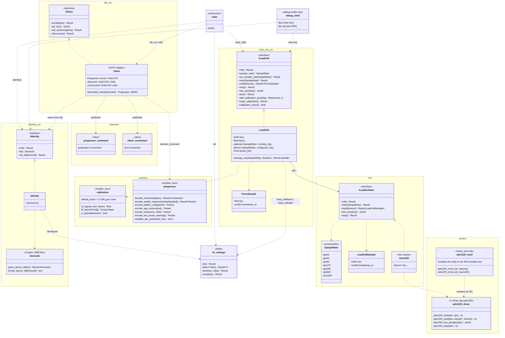

# app_main design

How `app_main`'s interfaces, classes, modules and drivers fit together, and what each offers. Keep this diagram in step with the code: a change to an interface or a new component updates it in the same commit.

Conventions: `<<interface>>` classes are the seams that tests mock; a solid arrow is a reference held by an object, a dashed arrow is a call or use. Methods return `fw::Result` (`Result~T~` here) unless shown otherwise. Mocks (`hal::mocks::MockLoadCellAdc`, `load_cell_svc::MockLoadCell`, `ble_svc::MockClient`) implement each interface for unit tests and are left out to keep the diagram readable.

Nothing observes the channels yet: the measurement manager (next) handles the commands, turns `ForceSample`s into `progressor` packets, and answers through `ble_svc::client()`.

## Production wiring

Each component's production file binds the concrete types (see `docs/architecture.md`, Component pattern):

| Accessor | Instance | Bound to |
|---|---|---|
| `identity_svc::identity()` | `Identity` | settings key `identity/id` |
| `ble_svc::client()` | `Client` in `ble_svc.cpp` | Bluetooth: the Progressor GATT service, advertising as `Progressor_NNNN` (NNNN from the device ID) |
| `load_cell_svc::load_cell()` | `LoadCell` on `hal::zephyr::Ads1220` | devicetree alias `load-cell-adc`: the ADS1220 on the XIAO's SPI (`/CS` P1.00, `/DRDY` P1.31), or the emulated chip on native_sim |
