# app_main design

How `app_main`'s interfaces, classes, modules and drivers fit together, and what each offers. Keep this diagram in step with the code: a change to an interface or a new component updates it in the same commit.

```mermaid
classDiagram
    direction TB

    class main {
        <<entry point>>
        main()
    }

    namespace measurement_manager {
        class Measurement {
            <<manager thread>>
            +start() Result
            +handle(Event) Result
            +measuring() bool
            +sample() Result
            +dropped_batches() uint32
        }
        class Event {
            <<tagged union>>
            command: progressor::Command
            client_connection: ClientConnection
        }
    }

    namespace power_manager {
        class Power {
            <<manager thread>>
            +handle(Event) Result
            +next_check() milliseconds
            is_low(BatteryStatus) bool
        }
    }

    class debug_shell {
        <<debug builds only>>
        jkp id [set hex]
        jkp rate [set SPS]
        jkp battery
    }

    namespace identity_svc {
        class IIdentity {
            <<interface>>
            +init() Result
            +id() DeviceId
            +set_id(DeviceId) Result
        }
        class Identity {
            -DeviceId id_
        }
        class DeviceId {
            <<6 bytes, MSB first>>
            parse_device_id(hex) Result~DeviceId~
            format_device_id(DeviceId) text
        }
    }

    namespace load_cell_svc {
        class ILoadCell {
            <<interface>>
            +init() Result
            +sample_rate() SampleRate
            +set_sample_rate(SampleRate) Result
            +start(SampleRate) Result
            +read(timeout) Result~ForceSample~
            +stop() Result
            +lost_samples() uint32
            +tare() Result
            +add_calibration_point(kg) Result~size_t~
            +reset_calibration() Result
            +calibration_factor() float
        }
        class LoadCell {
            -int32 tare_
            -float factor_
            -optional~SampleRate~ running_rate_
            -atomic~SampleRate~ configured_rate_
            -Point points_[20]
            -average_raw(SampleRate, duration) Result~double~
        }
        class ForceSample {
            +float kg
            +uint64 timestamp_us
        }
    }

    namespace ble_svc {
        class IClient {
            <<interface>>
            +send(bytes) Result
            +att_mtu() uint16
            +set_streaming(bool) Result
            +disconnect() Result
        }
        class Client {
            <<GATT adapter>>
            Progressor service 7e4e1701
            data point 7e4e1702: notify
            control point 7e4e1703: write
            advertised_name(DeviceId) Progressor_NNNN
        }
    }

    namespace pmic_svc {
        class IPmic {
            <<interface>>
            +init() Result
            +read_battery() Result~BatteryStatus~
            +ship_mode() Result
        }
        class Pmic
    }

    namespace channels {
        class progressor_command {
            <<zbus>>
            progressor::Command
        }
        class client_connection {
            <<zbus>>
            bool connected
        }
        class battery {
            <<zbus>>
            hal::BatteryStatus
        }
    }

    namespace modules {
        class calibration {
            <<module, pure>>
            default_factor = 0.109 g per code
            to_kg(raw, tare, factor) float
            fit_factor(Point[]) Result~float~
            is_plausible(factor) bool
        }
        class progressor {
            <<module, pure>>
            decode_command(bytes) Result~Command~
            encode_weight_measurements(Sample[]) Result~Packet~
            encode_battery_voltage(mV) Packet
            encode_app_version(text) Packet
            encode_progressor_id(id) Packet
            encode_low_power_warning() Packet
            samples_per_packet(att_mtu) size_t
        }
    }

    namespace hal {
        class ILoadCellAdc {
            <<interface>>
            +init() Result
            +start(SampleRate) Result
            +read(timeout) Result~LoadCellSample~
            +lost_samples() uint32
            +stop() Result
        }
        class SampleRate {
            <<enumeration>>
            sps20
            sps45
            sps90
            sps175
            sps330
            sps600
            sps1000
        }
        class LoadCellSample {
            +int32 raw
            +uint64 timestamp_us
        }
        class Ads1220 {
            <<hal::zephyr>>
            -device* dev_
        }
        class IBatteryCharger {
            <<interface>>
            +init() Result
            +read() Result~BatteryStatus~
        }
        class BatteryStatus {
            +uint32 millivolts
            +bool charging
            +bool external_power
        }
        class IPowerOff {
            <<interface>>
            +init() Result
            +power_off() Result
        }
        class Npm13xxCharger {
            <<hal::zephyr>>
            Zephyr nPM13xx charger sensor
        }
        class RegulatorShipMode {
            <<hal::zephyr>>
            regulator_parent_ship_mode()
        }
    }

    namespace drivers {
        class ads1220_driver {
            <<C driver, jkp,ads1220>>
            ads1220_start(dev, sps) int
            ads1220_read(dev, sample*, timeout) int
            ads1220_lost_samples(dev) uint32
            ads1220_stop(dev) int
        }
        class ads1220_emul {
            <<native_sim only>>
            emulates the chip on the SPI emulator bus
            ads1220_emul_set_raw(raw)
            ads1220_emul_set_source(fn)
        }
        class npm1300_emul {
            <<native_sim only>>
            nPM1300 registers on the I2C emulator bus
            npm1300_emul_set_battery_mv(mV)
            npm1300_emul_set_charging(bool)
            npm1300_emul_set_vbus(bool)
        }
    }

    class fw_settings {
        <<lib/fw>>
        init() Result
        load~T~(key) Result~T~
        save(key, value) Result
        erase(key) Result
    }

    IIdentity <|.. Identity
    ILoadCell <|.. LoadCell
    IClient <|.. Client
    ILoadCellAdc <|.. Ads1220
    IPmic <|.. Pmic
    IBatteryCharger <|.. Npm13xxCharger
    IPowerOff <|.. RegulatorShipMode

    main ..> IIdentity : identity()
    main ..> ILoadCell : load_cell()
    main ..> fw_settings : init
    main ..> Client : ble_svc init()
    main ..> Measurement : measurement_manager start()
    main ..> IPmic : pmic() init
    main ..> Power : power_manager start()
    debug_shell ..> IIdentity
    debug_shell ..> ILoadCell : rate only
    debug_shell ..> battery : reads

    Identity ..> fw_settings : "identity/id"
    Identity ..> DeviceId
    LoadCell --> ILoadCellAdc : adc_
    LoadCell ..> calibration
    LoadCell ..> fw_settings : "load_cell/factor", "load_cell/rate"
    LoadCell ..> ForceSample
    ILoadCellAdc ..> SampleRate
    ILoadCellAdc ..> LoadCellSample
    Measurement --> ILoadCell : load_cell_
    Measurement --> IClient : client_
    Measurement ..> progressor : encode responses and samples
    Measurement ..> Event
    Measurement ..> battery : reads for 0x6F
    Power --> IPmic : pmic_
    Power --> IClient : low-power warning
    Power ..> battery : publishes
    Pmic --> IBatteryCharger : charger_
    Pmic --> IPowerOff : power_off_
    IBatteryCharger ..> BatteryStatus
    npm1300_emul ..> Npm13xxCharger : answers Zephyr's drivers over I2C
    progressor_command ..> Event : listener, queue
    client_connection ..> Event : listener, queue
    Client ..> progressor : decode_command
    Client ..> progressor_command : publishes
    Client ..> client_connection : publishes
    Client ..> IIdentity : name from id()
    Ads1220 ..> ads1220_driver
    ads1220_emul ..> ads1220_driver : answers its SPI
```

Conventions: `<<interface>>` classes are the seams that tests mock; a solid arrow is a reference held by an object, a dashed arrow is a call or use. Methods return `fw::Result` (`Result~T~` here) unless shown otherwise. Mocks (`hal::mocks::MockLoadCellAdc`, `MockBatteryCharger`, `MockPowerOff`, `load_cell_svc::MockLoadCell`, `ble_svc::MockClient`, `pmic_svc::MockPmic`) implement each interface for unit tests and are left out to keep the diagram readable.

The measurement manager's thread takes `Event`s off its queue (fed by a zbus listener on both channels) and, while measuring, calls `sample()` between them: each `ForceSample` becomes a `progressor::Sample` with its time since the measurement started, and batches of up to 50 ms (at most what one notification carries) go out through `ble_svc::client()`. It is the only caller of `ILoadCell`'s single-threaded operations; the debug shell only uses the thread-safe sample rate.

The power manager's thread reads the battery every 30 s (its timer posts an `Event`) and publishes it on `channels::battery`, which the measurement manager answers 0x6F from. A reading at or below 3.3 V with no charging or USB power is confirmed 1 s later; then the client gets the 0x04 low-power warning and, 0.5 s later, the PMIC enters ship mode. It is the only caller of `IPmic`.

## Production wiring

Each component's production file binds the concrete types (see `docs/architecture.md`, Component pattern):

| Accessor | Instance | Bound to |
|---|---|---|
| `identity_svc::identity()` | `Identity` | settings key `identity/id` |
| `measurement_manager::start()` | `Measurement` in `measurement_manager.cpp`, built on first use | `load_cell()`, `client()`, and the device ID as at boot; thread priority 2 |
| `power_manager::start()` | `Power` in `power_manager.cpp`, built on first use | `pmic()`, `client()`; thread priority 7 |
| `pmic_svc::pmic()` | `Pmic` on `hal::zephyr::Npm13xxCharger` and `RegulatorShipMode` | devicetree aliases `pmic-charger` and `pmic-regulators`: the XIAO's nPM1300 (bit-banged I2C on P1.18/P1.17), or the emulated chip on native_sim |
| `ble_svc::client()` | `Client` in `ble_svc.cpp` | Bluetooth: the Progressor GATT service, advertising as `Progressor_NNNN` (NNNN from the device ID) |
| `load_cell_svc::load_cell()` | `LoadCell` on `hal::zephyr::Ads1220` | devicetree alias `load-cell-adc`: the ADS1220 on the XIAO's SPI (`/CS` P1.00, `/DRDY` P1.31), or the emulated chip on native_sim |
